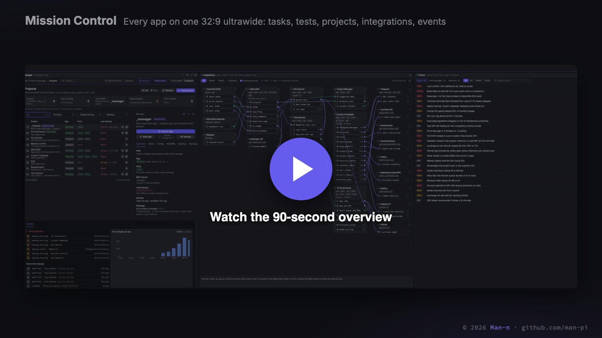

# Man-π

Modular apps, connected by AI agent pipelines, from brainstorm to shipped, tested app. Agents build, push and test every task on their own; a human only signs off.

▶ **[Watch the 90-second overview](media/platform-overview.mp4)** (with voiceover)

## The pipeline

| Step | App | What happens |
|---|---|---|
| 1 | [MemoPile](https://github.com/man-pi/memopile-showcase) | Ideas and notes become tasks. Claude extracts, triages and prioritises them. Web and iOS. |
| 2 | [Dev Runner](https://github.com/man-pi/dev-runner-showcase) | Picks up tasks marked Ready for dev and builds them with headless Claude Code inside strict guard-rails. |
| 3 | [Test_Runner](https://github.com/man-pi/test-runner-showcase) | Runs Playwright, Cypress, Jest and k6 on every handed-over task, plus LLM-as-judge evals for AI output. |
| 4 | Human | Sign-off. The only manual step. |

## Running the platform

| App | What it does |
|---|---|
| [Project Manager](https://github.com/man-pi/project-manager-showcase) | Scaffolds each app, keeps the port registry, MCP registration, device locks and scheduled backups. |
| [Mission Control](https://github.com/man-pi/mission-control-showcase) | Every app side by side on a 32:9 ultrawide, an integration map, and one central event log for all agents. |

Built with Claude Code. Source code is private and available on request.

© 2026 Man-π. All rights reserved. See [LICENSE](LICENSE).
